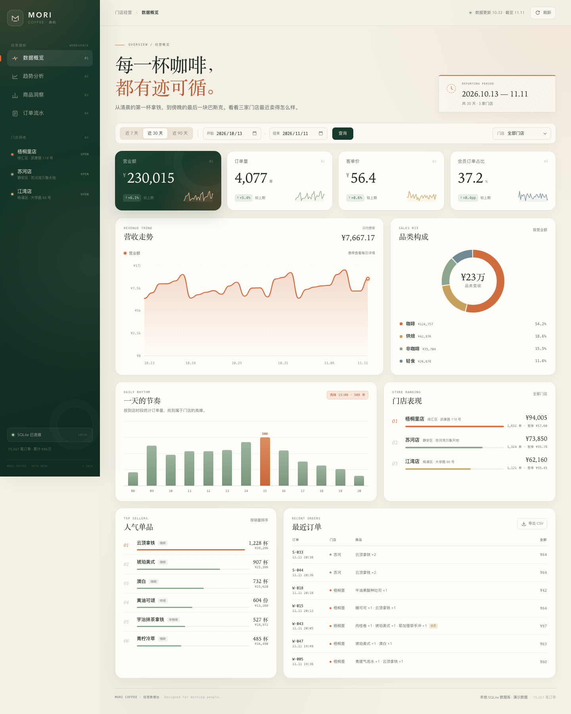

# MORI COFFEE · 经营数据台

一个前后端分离的咖啡门店经营数据看板：**Nuxt 4 前端 + Spring Boot 3 后端 + SQLite 数据库**。



## 架构

```text
浏览器
  │
  ▼
Nuxt 4 前端  http://127.0.0.1:3000
  │   REST / JSON（CORS）
  ▼
Spring Boot 3 后端  http://127.0.0.1:8080/api
  │   Spring JDBC
  ▼
SQLite  backend/data/mori-coffee.db
```

前后端分别独立启动、独立构建。后端只负责数据聚合与 CSV 导出，图表由前端使用 SVG 绘制。

## 功能

- **核心指标**：营业额、订单量、客单价、会员订单占比，自动对比上一等长周期。
- **筛选**：近 7 / 30 / 90 天，自定义起止日期，全部门店或单店。
- **图表**：SVG 营收面积折线图、品类环形图、时段订单柱状图，折线图支持悬停查看每日数据。
- **经营分析**：门店营收排名、Top 6 人气单品、最近订单流水。
- **CSV 导出**：按照当前日期与门店筛选条件导出带 BOM 的 CSV。
- **交互与响应式**：数字滚动、加载骨架、Toast、URL 筛选状态同步、移动端抽屉导航与订单卡片。
- **自动初始化**：SQLite 表不存在时自动建表；没有订单时自动生成 120 天演示数据。

## 技术栈

| 层 | 技术 |
| --- | --- |
| 前端 | Nuxt 4.6 / Vue 3.5 / TypeScript / 原生 CSS / SVG |
| 前端运行时 | Node.js 24（也兼容 Node.js 22.22.3+） |
| 后端 | Java 17 / Spring Boot 3.5 / Spring JDBC |
| 数据库 | SQLite + `sqlite-jdbc` |
| 构建 | npm / Maven |

## 目录结构

```text
.
├── frontend/                       # Nuxt 前端
│   ├── app/
│   │   ├── components/             # 侧边栏、图表、订单表格等
│   │   ├── composables/
│   │   │   └── useDashboard.ts     # 筛选、API 请求、URL 同步
│   │   ├── pages/index.vue         # 看板页面
│   │   ├── utils/format.ts
│   │   ├── types/dashboard.ts
│   │   ├── assets/css/main.css
│   │   └── app.vue
│   ├── public/favicon.svg
│   ├── nuxt.config.ts
│   ├── package.json
│   └── package-lock.json
│
├── backend/                        # Spring Boot 后端
│   ├── src/main/java/com/mori/dashboard/
│   │   ├── controller/             # REST API
│   │   ├── service/                # 查询解析与指标计算
│   │   ├── repository/             # SQLite 查询
│   │   ├── seed/                   # Java 演示数据生成器
│   │   ├── dto/
│   │   ├── config/
│   │   └── exception/
│   ├── src/main/resources/
│   │   ├── application.yml
│   │   └── schema.sql
│   ├── src/test/
│   ├── data/mori-coffee.db         # 已包含演示数据
│   └── pom.xml
│
├── docs/preview.png
└── README.md
```

## 快速启动

### 环境要求

- Java 17+
- Maven 3.9+
- Node.js 24.15+（或 Node.js 22.22.3+）
- npm

### 1. 启动后端

```bash
cd backend
mvn spring-boot:run
```

后端地址：<http://127.0.0.1:8080>

健康检查：

```bash
curl http://127.0.0.1:8080/api/health
```

### 2. 启动前端

另开一个终端：

```bash
cd frontend
npm install
npm run dev
```

打开 <http://127.0.0.1:3000>。

前端默认访问 `http://127.0.0.1:8080/api`。如果后端端口不同，启动前端时覆盖：

```bash
NUXT_PUBLIC_API_BASE=http://127.0.0.1:9090/api npm run dev
```

## 配置

### 后端

| 环境变量 | 默认值 | 说明 |
| --- | --- | --- |
| `SERVER_PORT` | `8080` | 后端端口 |
| `DB_PATH` | `./data/mori-coffee.db` | SQLite 文件路径，相对 `backend/` 运行目录 |
| `CORS_ORIGINS` | `http://localhost:*,http://127.0.0.1:*` | 允许的前端来源，逗号分隔 |
| `SEED_ENABLED` | `true` | 数据库为空时是否自动生成演示数据 |

示例：

```bash
SERVER_PORT=9090 DB_PATH=./data/dev.db mvn spring-boot:run
```

### 前端

| 环境变量 | 默认值 | 说明 |
| --- | --- | --- |
| `NUXT_PUBLIC_API_BASE` | `http://127.0.0.1:8080/api` | 后端 API 根地址 |
| `PORT` | `3000` | Nuxt 生产服务端口 |

## API

| 方法 | 路径 | 说明 |
| --- | --- | --- |
| GET | `/api/health` | 服务状态、订单量、数据日期范围 |
| GET | `/api/dashboard` | 看板聚合数据 |
| GET | `/api/orders/export` | 导出当前筛选结果的 CSV |

`/api/dashboard` 与导出接口支持：

| 参数 | 格式 | 说明 |
| --- | --- | --- |
| `start` | `YYYY-MM-DD` | 开始日期 |
| `end` | `YYYY-MM-DD` | 结束日期（包含当天） |
| `store` | 数字 | 门店 ID；省略表示全部门店 |

不传日期时，默认返回数据集中最后 30 天。单次查询最多 366 天，参数不合法返回 `400` 和 `{"error":"..."}`。

```bash
curl "http://127.0.0.1:8080/api/dashboard?start=2026-10-01&end=2026-10-31&store=2"

curl -OJ "http://127.0.0.1:8080/api/orders/export?start=2026-10-01&end=2026-10-31"
```

## 数据库

SQLite 中有四张表：

- `stores`：门店
- `products`：商品
- `orders`：订单主表
- `order_items`：订单明细

当前包含 3 家门店、15,261 笔订单，日期范围 `2026-07-15` 至 `2026-11-11`，累计营业额约 86 万元。

首次启动时：

1. Spring Boot 执行 `schema.sql` 建表和索引；
2. `DataSeeder` 检查 `orders` 是否为空；
3. 如果为空，用固定随机种子生成 120 天演示数据；
4. 如果已有数据则直接跳过。

如需重置演示数据库：

```bash
# 先停止后端
rm backend/data/mori-coffee.db
cd backend && mvn spring-boot:run
```

## 构建与生产运行

### 后端

```bash
cd backend
mvn clean package
java -jar target/mori-coffee-backend-1.0.0.jar
```

### 前端

```bash
cd frontend
npm run build
PORT=3000 NUXT_PUBLIC_API_BASE=http://127.0.0.1:8080/api node .output/server/index.mjs
```

生产环境需要把 `CORS_ORIGINS` 设置为实际前端地址，例如：

```bash
CORS_ORIGINS=https://dashboard.example.com java -jar target/mori-coffee-backend-1.0.0.jar
```

## 校验命令

```bash
cd frontend
npm run typecheck
npm run build

cd ../backend
mvn test
```

已验证：后端自动建表与种子数据生成、默认/自定义日期和门店筛选、CSV 下载、CORS 预检、Nuxt 交互、移动端布局、错误状态与重试；浏览器控制台无报错。

## 说明

- 品牌、门店、商品和订单数据均为虚构，仅用于演示。
- 后端接口目前均为只读查询，不提供写入 API。
- 前端不依赖外部图表库或 CDN，断网环境也能正常展示。
