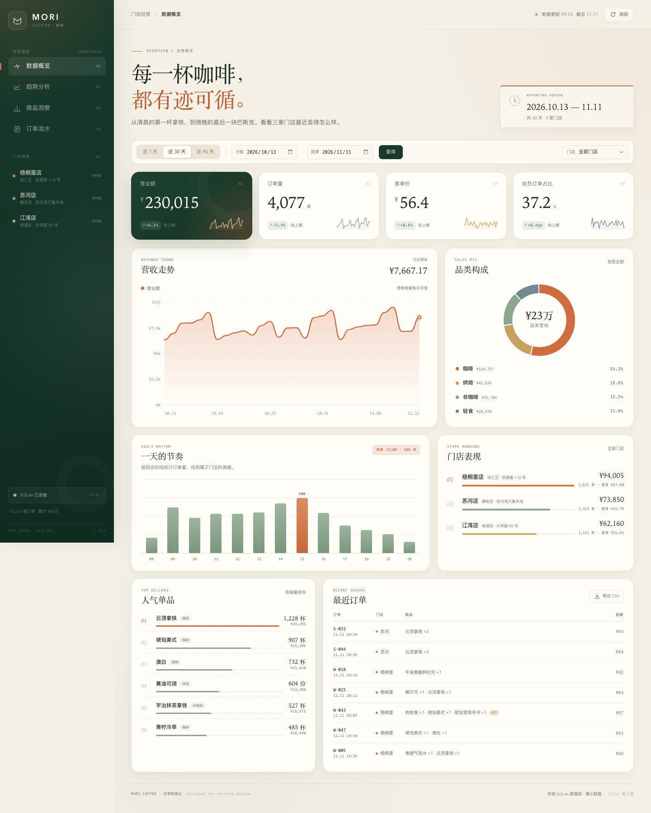

# MORI COFFEE · 经营数据台

一个带前端、后端和 SQLite 数据库的数据展示网页。以三家独立咖啡门店的经营数据为场景，把营业额、订单趋势、品类构成、时段分布、门店排名和最近订单放在同一块看板里。



## 快速启动

项目使用 Node.js 24 内置的 `node:http` 与 `node:sqlite`，**没有第三方依赖，不需要安装依赖包**。

```bash
cd pjct261112
npm start
```

或者直接：

```bash
node server.js
```

打开 <http://127.0.0.1:4173>。

> 需要 Node.js 22.5 及以上。Node.js 22 运行时如果提示 `node:sqlite` 不可用，可使用 `node --experimental-sqlite server.js`；Node.js 24 可直接运行。也可以通过 `PORT=5173 npm start` 更换端口，或用 `HOST=0.0.0.0` 允许局域网访问。

## 功能

- **核心指标**：营业额、订单量、客单价、会员订单占比，并与上一个等长周期自动对比。
- **时间筛选**：近 7 / 30 / 90 天快捷范围，也支持自定义起止日期。
- **门店筛选**：支持全部门店或单店视角，指标、图表和订单会同步刷新。
- **营收走势**：手写 SVG 面积折线图，悬停显示每日营业额与订单量。
- **品类构成**：SVG 环形图展示咖啡、非咖啡、烘焙、轻食的营收占比。
- **时段节奏**：按小时统计订单量，自动标出高峰时段。
- **门店与商品**：门店营收排名、Top 6 人气单品。
- **订单流水**：最近订单表格，可按照当前筛选条件导出带 BOM 的 CSV 文件。
- **响应式布局**：桌面端侧边栏、窄屏抽屉导航、移动端订单卡片布局。
- **交互细节**：数字滚动、图表绘制动画、骨架占位、加载条、Toast 提示、URL 筛选状态同步，以及 `prefers-reduced-motion` 降级。

## 技术栈

| 层 | 实现 |
| --- | --- |
| 前端 | 原生 HTML / CSS / JavaScript，无框架、无图表库 |
| 图表 | 运行时生成 SVG 与 CSS 动画 |
| 后端 | Node.js 内置 `http` 模块，手写路由和参数校验 |
| 数据库 | SQLite，Node.js 内置 `node:sqlite` |
| 数据 | 可重复生成的三门店 120 天演示订单 |

## 目录结构

```text
.
├── server.js              # HTTP 服务、API、静态文件与 CSV 导出
├── database.js            # SQLite 连接、建表与索引
├── seed.js                # 演示数据生成器
├── data/
│   └── mori-coffee.db     # 已生成的 SQLite 数据库
├── public/
│   ├── index.html         # 页面结构
│   ├── styles.css         # 视觉、响应式与动画
│   ├── app.js             # 数据请求、图表渲染与交互
│   └── favicon.svg
├── docs/
│   └── preview.png
├── package.json
└── README.md
```

## API

所有接口均为只读 GET 请求。

| 接口 | 说明 |
| --- | --- |
| `GET /api/health` | 服务状态、数据库订单量和数据日期范围 |
| `GET /api/dashboard` | 看板聚合数据，未传日期时默认展示数据集中最后 30 天 |
| `GET /api/orders/export` | 按筛选条件导出 CSV |

`/api/dashboard` 与导出接口支持以下查询参数：

- `start`：开始日期，格式 `YYYY-MM-DD`
- `end`：结束日期，格式 `YYYY-MM-DD`（含当天）
- `store`：门店 ID，省略表示全部门店

示例：

```bash
curl "http://127.0.0.1:4173/api/dashboard?start=2026-10-01&end=2026-10-31&store=2"
curl -OJ "http://127.0.0.1:4173/api/orders/export?start=2026-10-01&end=2026-10-31"
```

单次查询最多 366 天；日期或门店参数不合法时返回 `400` 和 JSON 错误信息。

## 数据说明

首次启动时如果数据库为空，会自动生成演示数据。也可以手动重建：

```bash
# 建议先停止正在运行的服务，再执行
npm run seed
```

生成器使用固定随机种子，因此数据分布可重复；日期范围会以运行脚本时的「昨天」为结束日，向前生成 120 天。每家门店的订单量受工作日、周末、月初和缓慢增长趋势影响，客单结构、支付方式与会员比例也带有随机性。

数据库包含四张表：

- `stores`：门店
- `products`：商品与品类
- `orders`：订单主表
- `order_items`：订单明细

## 说明

- 页面默认只在本地监听 `127.0.0.1`，外部接口只提供查询，不开放写入。
- 所有第三方依赖为 0，界面字体使用系统字体，断网也能正常展示。
- 演示数据、品牌名与门店信息均为虚构。
